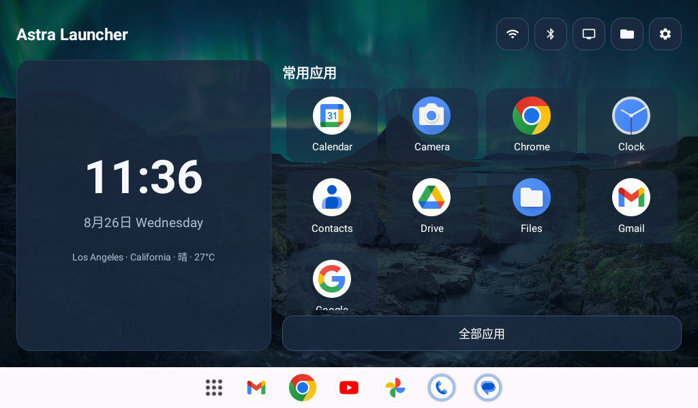

# Astra Launcher

Astra Launcher 是一个面向 Android 8+ 横屏设备的轻量桌面原型，提供桌面和按需使用的高级工具。不包含原厂桌面接管、无障碍服务或悬浮控件。



## 当前功能

- Kotlin + 传统 View/XML，最低支持 API 26。
- 声明 `HOME`、普通 `LAUNCHER` 和 `LEANBACK_LAUNCHER` 入口。
- 同一套响应式主页同时支持直接触摸和方向键焦点，不提供设备模式选择。
- 合并枚举普通与 Leanback 应用入口，并按 Activity 组件去重。
- 2×4 触摸收藏网格和 6 列方向焦点网格。
- 全部应用、应用启动、收藏切换和系统应用信息入口。
- 公网 IP 粗略地点与当前天气，支持多数据源降级和本地缓存。
- 每日图片主页背景，依次尝试 Bing、Wikimedia Commons POTD 和 NASA APOD。
- 主页右上角直接提供纯图标的 Wi-Fi、蓝牙、信号源、文件和 Astra 设置入口。
- Wi-Fi、蓝牙只打开系统页面，不直接修改配置；系统设置入口位于 Astra 设置页。
- 通过 Android TV Input Framework 枚举并打开系统报告的外部信号源。
- 全部二级页面均有明确返回按钮；主页不会因 Back 而退出。
- 设置内提供 Activity 浏览与启动、应用权限 Shell、局域网上传安装 APK。
- 申请网络、完整应用列表查询和请求安装 APK 权限，不申请定位、悬浮窗或无障碍权限。

## 高级工具（0.2.0）

从首页右上角设置进入：

- **Activity 浏览与启动**：按应用浏览和搜索 Activity，查看组件名称、导出状态及权限，复制组件、收藏、手动输入组件。普通 Astra 只能启动已启用、已导出且权限满足的页面；有些工程页面仍可能要求额外参数。收藏保存在 Activity 工具自己的列表中。完整枚举无桌面入口的系统应用需要 `QUERY_ALL_PACKAGES`，因此对此权限的通用 Lint 提示做了单点说明与抑制；若发布到 Google Play，需评估其应用列表权限政策。
- **Shell 命令**：通过系统 `/system/bin/sh` 执行非交互命令，显示当前应用 UID、合并输出和退出码，支持停止、示例与最近 20 条历史。使用系统 `setsid` 隔离进程组，命令结束或离开工具页时清理子进程；输出保留最近 65,536 字符。它没有 ADB shell 或 root 权限，系统命令仍受 Android 的访问控制限制。
- **局域网安装 APK**：进入接收页并点击“开启接收”，同一局域网的手机或电脑在浏览器输入显示的 HTTP 地址和配对码，选择单个 APK 上传，再在设备上点击安装。首次需要允许 Astra 安装未知应用，每次安装交由系统确认；不需要 U 盘、ADB 或 root。网页资源全部内置，APK 存在应用私有缓存中，已完成的上传可跨页面重建恢复，点击清除即可删除。接收服务在离开页面或 15 分钟后停止，单个 APK 上限 256 MiB。暂不解析 APKS/XAPK 等打包格式，也不提供静默安装。

接收端每次开启时由系统自动分配空闲 TCP 端口，接收期间端口不变，重新开启后可能变化，请以页面上的完整地址为准。需要手机/电脑与设备之间可以互访（访客 Wi-Fi 的设备隔离会阻止连接）。模拟器处于 NAT 网络中，调试时可用 `adb -s emulator-5554 forward tcp:18080 tcp:<页面显示的端口>` 后从电脑访问 `http://127.0.0.1:18080`（先将占位符替换为实际端口）；真机直接使用页面上的局域网地址。

## 地点与天气

网络请求不进入首屏启动路径：主页先显示本地缓存，再在后台刷新。

- 地点：优先 IPWhois；没有可用坐标时备用 wttr.in。
- 天气：优先 Open-Meteo；备用 wttr.in。
- 离线：所有网络源失败时继续显示最近一次成功结果。
- 刷新：地点最多每 24 小时一次，天气最多每 30 分钟一次。
- 隐私：不读取 GPS，不保存公网 IP；IP 定位可能落在运营商或 VPN 的出口城市。

Open-Meteo 免费接口仅适用于非商业用途并要求署名；完整的数据来源、许可和隐私说明统一放在 Astra 的设置页。

## 每日图片

主页先显示最近一次成功图片，再在后台按 `Bing → Wikimedia Commons POTD → NASA APOD` 的顺序刷新当天图片。候选文件下载完成并通过尺寸与格式校验后才会替换旧缓存；全部来源失败时继续使用最近缓存。当前不附带内置壁纸，没有缓存时保留 Astra 的纯色渐变背景。

设置页显示当前图片的标题、来源、作者或版权及许可，并提供来源页面入口。NASA APOD 当天为视频时会被跳过。

## 快捷设置与信号源

主页只有在系统能解析对应标准 Intent 时才显示 Wi-Fi 或蓝牙入口。信号源页只显示 `TvInputManager` 报告的 HDMI、AV 等透传输入；点击信号源会使用标准 TV 内容 URI，查询 `ACTION_VIEW` 和 `ACTION_MAIN` 播放入口。优先使用明确匹配 TV 内容的处理器，其次才尝试系统应用声明的 cursor MIME 兼容入口；同等级优先 `ACTION_VIEW`，多个播放器会显示选择器。通用文件编辑器或安装器的全类型匹配不会被当成 TV 播放入口。由于部分电视不会在应用列表中公开系统设置，Astra 设置页始终保留一个可用时显示的“打开系统设置”入口。

“文件”入口优先打开系统声明的文件管理应用；旧系统或没有完整文件管理器时，降级到 Storage Access Framework 文档选择器。选择器可以浏览系统暴露的 U 盘等存储位置，选中文件后 Astra 会将其交给对应的播放器或查看器。整个流程不申请存储权限。

当前版本不检查品牌、型号或厂商包名，也不内置小米、联发科等私有输入面板。普通手机模拟器没有 TV 输入服务，因此会显示“没有报告可用的外部信号源”；需要在真实电视上验证切换行为。

## 构建

推荐使用 Android Studio 自带的 JDK 21：

```bash
./gradlew testDebugUnitTest assembleDebug
```

Debug APK 输出到：

```text
app/build/outputs/apk/debug/app-debug.apk
```

### GitHub Actions 自动构建

每次推送或提交 PR 都会触发 `Android build`，也可以在仓库的 **Actions → Android build → Run workflow** 手动运行。工作流使用 Ubuntu 24.04、Temurin JDK 21 和项目自带的 Gradle Wrapper，依次运行单元测试、Android Lint 和 Debug APK 构建。

构建成功后，在对应运行页面的 **Artifacts** 中下载 `astra-launcher-debug-<commit SHA>`，解压即可得到 `app-debug.apk`。测试与 Lint 报告单独上传为 `astra-launcher-reports-<commit SHA>`；失败时也会尽量保留已经生成的报告。产物保留 14 天。

Debug 构建无需配置 Secrets。工作流只有仓库内容读取权限，不自动发布 GitHub Release。Actions 固定到具体提交，Gradle 缓存只允许默认分支的非 PR 构建写入。

Debug 产物仅用于测试，其签名可能因构建环境不同而变化。日常安装请使用 `main` 的推送或手动运行生成的 `astra-launcher-release-<commit SHA>`：其中的 `app-release.apk` 使用与 Astra TV 相同的 Astra Sec 正式证书签名，保留 30 天；混淆映射单独保存在 `astra-launcher-mapping-<commit SHA>`。构建会检查 Release Lint 并核对 APK 证书指纹。PR 和其他分支不使用正式密钥，只生成 Debug 包。

本地正式构建默认读取仓库外的 `~/.android/astra-sec/signing.properties`：

```bash
./gradlew --no-configuration-cache assembleRelease testDebugUnitTest lintRelease
```

输出为 `app/build/outputs/apk/release/app-release.apk`。签名配置、GitHub Secrets 和迁移说明见 [签名管理](docs/signing/README.md)。**正式签名不能覆盖旧 Debug 签名安装**；首次迁移需先记录或导出设置，再卸载旧版（会清除应用数据）并安装正式包，之后沿用同一证书即可覆盖升级。

## 使用手机模拟器预览

普通手机模拟器足够验证横屏布局、触摸、应用抽屉、返回链路和方向键焦点。项目的 `LauncherActivity` 固定为横屏。

需要精确模拟 1024×600 时，可只在测试模拟器中执行：

```bash
adb shell wm size 1024x600
adb shell wm density 160
adb shell settings put system accelerometer_rotation 0
adb shell settings put system user_rotation 0
adb install -r app/build/outputs/apk/debug/app-debug.apk
adb shell am start -n org.astrasec.launcher/.LauncherActivity
```

方向键可通过模拟器键盘或 ADB 验证：

```bash
adb shell input keyevent KEYCODE_DPAD_LEFT
adb shell input keyevent KEYCODE_DPAD_RIGHT
adb shell input keyevent KEYCODE_DPAD_UP
adb shell input keyevent KEYCODE_DPAD_DOWN
adb shell input keyevent KEYCODE_DPAD_CENTER
adb shell input keyevent KEYCODE_BACK
```

恢复模拟器显示设置：

```bash
adb shell wm size reset
adb shell wm density reset
```

## 设计边界

代码不检查厂商品牌、机型、厂商包名或固定物理分辨率。触摸与方向键始终同时可用：触摸输入保持直接操作，方向键输入进入标准焦点导航。网格只根据当前窗口可用宽度响应式计算列数。外部应用中的系统级返回不属于 Launcher 本体。
